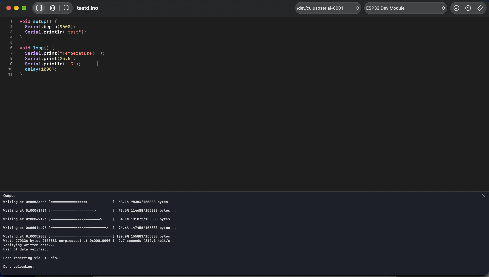

# Sketchpad 

A native macOS IDE for Arduino development built with SwiftUI powered by `arduino-cli`

[-blue?style=for-the-badge&logo=apple)](https://github.com/iluvicecream/Sketchpad2/releases/latest)



---

## Platform Support

**Sketchpad is currently only supported on macOS 27.0+ due to api availability.**

| Platform | Architecture | Status | Notes |
| :--- | :--- | :--- | :--- |
| **macOS** | Apple Silicon (`arm64`) | ✅ Supported | Pre-built `.dmg` available in [Releases](https://github.com/iluvicecream/Sketchpad2/releases/latest) |
| **macOS** | Intel (`x86_64`) | ⚠️ Source Build | Requires updating the `arduino-cli` archive URL to `macOS_64bit` |
| **Windows** | `x86_64` / `arm64` | ❌ Not Supported
| **Linux** | `x86_64` / `arm64` | ❌ Not Supported

---

## Quick Start & Installation

### Install on macOS (Pre-built Binary)

1. Download the latest `.dmg` from [**GitHub Releases**](https://github.com/iluvicecream/Sketchpad2/releases/latest).
2. Drag **Sketchpad.app** into your `/Applications` folder and launch it.

### Launching on macOS Without Gatekeeper Warnings

Because Sketchpad is distributed outside the Mac App Store without an Apple Developer ID notarization certificate, macOS Gatekeeper may show an **"unidentified developer"** or **"Sketchpad is damaged / Not Opened"** prompt on first launch.

To open the app
1. **Control-click** (or right-click) `Sketchpad.app` in `/Applications` and select **Open**.
2. If macOS still blocks the launch, open **System Settings → Privacy & Security**, scroll down to the **Security** section, and click **Open Anyway** next to `Sketchpad.app`.

---

## Building & Running Locally

If you want to build Sketchpad from source instead of using the pre-built release:

### Prerequisites

- **macOS** on Apple Silicon (`arm64`)
- **Xcode 27+** with **Swift 6.0** toolchain
- An active internet connection on first run (so Xcode can resolve Swift Package Manager dependencies and Sketchpad can fetch `arduino-cli` on first launch)

### Build Steps

1. Clone the repository:
   ```bash
   git clone https://github.com/iluvicecream/Sketchpad2.git
   cd Sketchpad2
   ```
2. Open the project in Xcode:
   ```bash
   open Sketchpad2.xcodeproj
   ```
3. Wait for Xcode to finish resolving Swift Package Manager dependencies (`grpc-swift-2`, `grpc-swift-nio-transport`, `grpc-swift-protobuf`), select the **Sketchpad2** scheme (`My Mac`), and press **`⌘R`** to build and run.

---

## How It Works

Sketchpad's `ArduinoDaemonServiceBox` spawns `arduino-cli daemon` once as a managed background child process listening on `127.0.0.1:50051`.
`ArduinoRPCServiceBox` connects over plaintext HTTP/2 using `grpc-swift-2` (`GRPCNIOTransportHTTP2`) and communicates via generated Protobuf types (`cc.arduino.cli.commands.v1.ArduinoCoreService`). Operations like index updates, core/library installation, compilation (`CompileRequest`), and flashing (`UploadRequest`) stream structured progress and `stdout`/`stderr` chunks directly back to the `@Observable` `BuildServiceBox` on the main actor.

---

## Credits & Acknowledgements

- [**Arduino CLI**](https://github.com/arduino/arduino-cli) — Powers board/library management, sketch compilation, port discovery, flashing, and the gRPC `.proto` service definitions.
- [**gRPC Swift 2**](https://github.com/grpc/grpc-swift-2) & [**gRPC Swift NIO Transport**](https://github.com/grpc/grpc-swift-nio-transport) — Native Swift concurrency gRPC client and HTTP/2 POSIX transport.
- [**SwiftProtobuf**](https://github.com/apple/swift-protobuf) — Protocol Buffers runtime for Swift used by the generated Arduino RPC bindings.
